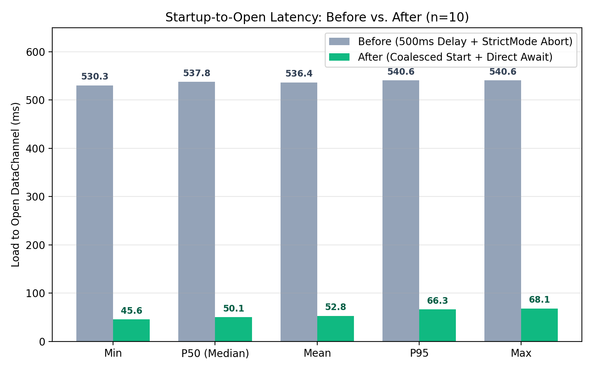
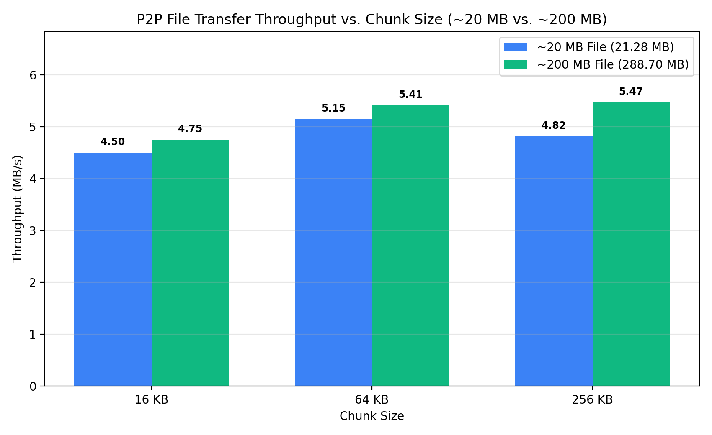
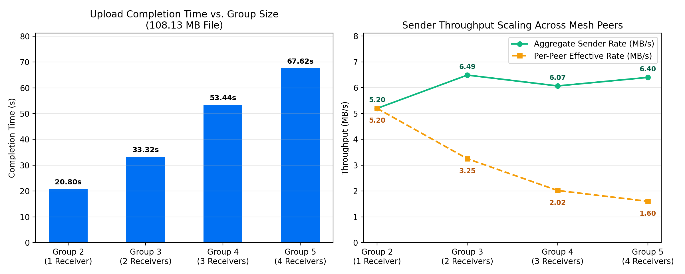
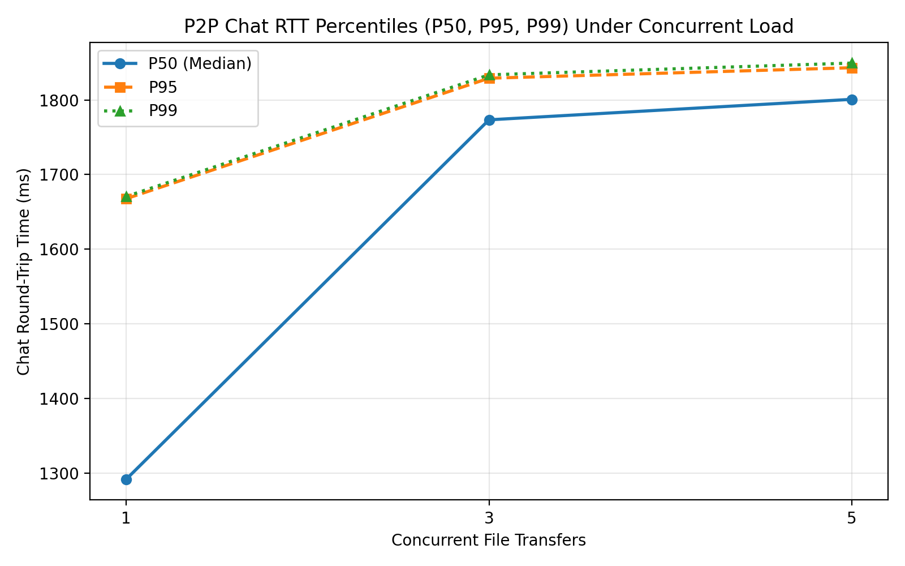

# P2P File Sharing & Chat

Browser-to-browser group chat and file transfer over **WebRTC data channels**. A small **.NET 9 SignalR** server introduces peers to each other, and after that **no chat messages or file data pass through any server**.

Built with React, TypeScript, WebRTC, IndexedDB, and ASP.NET Core SignalR.

---

## Features

- **Rooms:** join a named room; every member connects directly to every other member (full mesh).
- **Direct chat:** each pair of peers has a dedicated chat data channel.
- **Concurrent file transfers:** every transfer gets its own data channel, and each receiver gets its own send loop, so a slow peer doesn't slow down the others.
- **Backpressure:** the sender pauses when the channel's send buffer passes a threshold and continues on `bufferedamountlow`, so large files never flood browser memory.
- **Resumable transfers:** received data is saved to IndexedDB in ~1 MB batches. After a page reload or dropped connection, the receiver asks for the rest and the sender continues from the last saved chunk. At most ~1 MB is sent twice.
- **Cancel and discard:** senders can cancel; receivers can discard paused downloads.

---

## Architecture

```
               ┌──────────────────────────────┐
               │  Signaling server (.NET 9)   │  room membership +
               │  SignalR hub                 │  relays SDP / ICE only
               └───────▲──────────────▲───────┘
                       │ SignalR      │ SignalR
                ┌──────┴─────┐  ┌─────┴──────┐
                │  Browser A │◄►│  Browser B │   WebRTC data channels
                └────────────┘  └────────────┘   (encrypted, direct)
                       chat-channel  ─ one per peer pair
                       file-<uuid>   ─ one per transfer, per receiver
```

**Connecting:** when someone joins a room, the server tells the existing members, and each one sends the newcomer a WebRTC offer through the server. The newcomer never sends offers, which avoids both sides offering at once. ICE candidates that arrive before the offer or answer has been applied are held and added afterwards.

**Sending a file:**
1. The sender opens a `file-<uuid>` channel and sends metadata, including a `fileKey`: a SHA-256 of name, size and last-modified time.
2. The receiver checks IndexedDB for that key and replies with the chunk to start from (`0` for a new file).
3. The sender streams chunks from that point with backpressure.
4. The receiver saves the chunks in batches. When it has everything, it rebuilds the file, starts the download, and closes the channel to confirm delivery.

**Resuming:** transfers are matched by `fileKey`, not by peer ID, because peer IDs change on every reconnect. When a chat channel opens, the receiver sends a `resume-request` for each unfinished file. Any peer that still has the file continues the transfer. If the sender reloaded, picking the same file again resumes it automatically.

For a full walkthrough of the code, see [`CODE_WALKTHROUGH.md`](CODE_WALKTHROUGH.md).

---

## Getting started

**Requirements:** .NET 9 SDK and Node.js 18+.

```bash
# 1. Signaling server (http://localhost:5041)
cd server/src/P2PDataShare.Signaling
dotnet run

# 2. Client, in a second terminal (http://localhost:5173)
cd client
npm install
npm run dev
```

Open `http://localhost:5173` in two or more tabs, join the same room, then chat or attach files with 📎.

---

## Benchmarks

All tests ran on one machine, between Chrome tabs over loopback, so absolute speeds reflect a single machine, not a real network.

### Connection setup time



A peer was reloaded 10 times while auto-rejoining its room.Originally, a fixed 500 ms delay in App.tsx and React StrictMode negotiation aborts pushed page-load-to-open-channel time to **537.8 ms** (p50) (std dev **4.5 ms**).

Coalescing in-flight SignalR connection promises, removing the fixed 500 ms timer, and awaiting connection readiness before auto-rejoining cut p50 reconnect time by **90.7%**, down to **50.1** ms (p50) (45.6–68.1 ms across 10 reloads, 66.3 ms p95).

### Throughput vs. chunk size



Measured from the receiver's acknowledgement until it confirmed the whole file was saved:

| Chunk size | 21.28 MB file | 288.70 MB file |
|---|---|---|
| 16 KB | 4.50 MB/s | 4.75 MB/s |
| 64 KB | 5.15 MB/s | 5.41 MB/s |
| 256 KB | 4.82 MB/s | 5.47 MB/s |

- Going from 16 KB to 64 KB increased throughput **~14%** by cutting the number of slices, buffers and `send()` calls by 4×.
- 256 KB added only 1% on the large file and was slower on the small one.
- **64 KB is the best default:** nearly all the gain, while staying well under the 256 KB message-size limit browsers commonly support.

<!-- TODO: CHUNK_SIZE in webrtc.service.ts is 16 KB in the committed code. Change it to 64 KB to match this recommendation, or describe the benchmark build's configurable chunk size here. Note that 16 KB was originally chosen for cross-browser compatibility. -->

### Sending to more receivers (full mesh)



One sender uploaded a 108.13 MB file to 1–4 receivers (64 KB chunks):

| Receivers | Total sent | Time | Sender total | Per receiver |
|---|---|---|---|---|
| 1 | 108 MB | 20.8 s | 5.20 MB/s | 5.20 MB/s |
| 2 | 216 MB | 33.3 s | 6.49 MB/s | 3.25 MB/s |
| 3 | 324 MB | 53.4 s | 6.07 MB/s | 2.02 MB/s |
| 4 | 433 MB | 67.6 s | 6.40 MB/s | 1.60 MB/s |

- Sending 4× the data took 3.25× as long, because parallel per-receiver loops raised the sender's total rate by ~23% (5.20 → 6.40 MB/s).
- Receivers share the sender's capacity roughly evenly.
- The limit of a full mesh is visible here: the sender uploads one full copy per receiver, so per-receiver speed keeps falling as the room grows. Larger rooms would need peers to forward data to each other, or a relay server.

### Chat latency during file transfers (known issue)



A probe message was echoed back over the chat channel while 1, 3 or 5 large files were transferring. Round trips were timed on the sender's clock to avoid clock differences between tabs. 10 probes per level, 250 ms apart:

| Concurrent files | p50 | p95 | p99 |
|---|---|---|---|
| 1 | 1,292 ms | 1,668 ms | 1,671 ms |
| 3 | 1,773 ms | 1,829 ms | 1,834 ms |
| 5 | 1,801 ms | 1,843 ms | 1,850 ms |

**This shows a real problem: chat messages wait more than a second behind file data.** Latency stops growing beyond 3 files, but it plateaus at around 1.8 s, far too slow for chat.

- With one file, each probe took longer than the one before (682 ms → 1,671 ms over 2.5 s). That points to a queue that keeps growing, not a fixed cost.
- **Likely cause:** the receiver's main thread can't process chunks as fast as they arrive. The low loopback throughput (~5 MB/s) fits this. Incoming messages from all channels wait in one event queue, so the chat probe waits behind megabytes of chunks. Backpressure only limits the sender's buffer; nothing limits how far ahead of the receiver the sender can get.
- **Planned fix:** receiver-driven flow control, where the receiver grants the sender credit for N chunks at a time, so the receive queue stays short. Also, moving chunk handling off the main thread.
- **Measurement gaps:** there's no baseline with no files transferring, and with only 10 samples, p99 is effectively the maximum.

---

## Limitations

- **No TURN server.** Only STUN is configured, so peers behind strict NATs or firewalls can't connect. Production use would add a TURN relay (e.g. coturn) with short-lived credentials issued by the signaling server.
- **Full mesh,** so practical for small rooms only (see the mesh benchmark above).
- **Chat is delayed during large transfers** (see the chat latency benchmark above).
- **localhost only.** The hub URL and CORS origin are hard-coded.
- **The sender must keep its tab open,** or pick the same file again, for a resume to complete.
- **The file identity is a fingerprint** (name, size and modified time), not a hash of the contents. Data is still protected in transit by WebRTC's DTLS encryption.
- **A 500 ms fixed delay** before auto-rejoin (see connection setup above).
